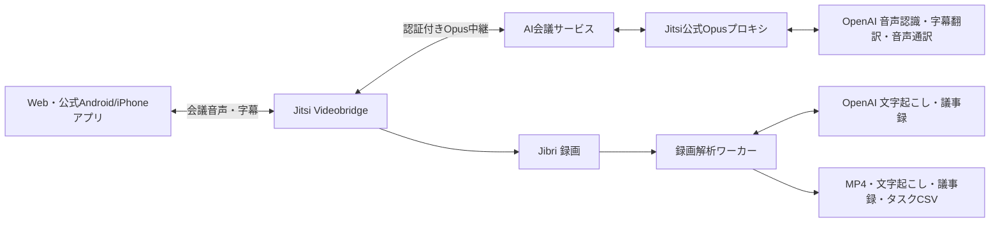

# jitsi-meet-ai

Jitsi MeetにAI通訳・字幕、録画後の議事録とタスク作成を追加する、独立した拡張プロジェクトです。OpenAI APIを使用し、日本語・英語・中国語・韓国語・ベトナム語を対象にしています。

上流のJitsi Meetを変更・公開するためのミラーやforkではありません。公式のJitsiパッケージと、コミットを固定した公式Opusプロキシに追加サービスを接続します。このリポジトリから上流へ変更を送る処理はありません。

## 機能

- 入力言語を自動認識し、Jitsi標準の字幕・音声トラックで通訳を配信します。
- Webと公式Android/iPhoneアプリの会議参加経路に対応します。通訳は参加時にはオフです。
- 会議中の文字起こし、録画の文字起こし、字幕翻訳、音声通訳、議事録のモデルを用途別に選択できます。
- Jibriで録画し、文字起こしTXT、議事録Markdown、タスクCSVを作成します。
- APIキーはサーバーに保存し、参加者には渡しません。管理者が作成したAI会議だけをAI中継対象にします。
- 日本語のWeb管理画面と、任意で生成して使える日本語のWeb音声案内を用意しています。

## 構成



APIサービスはFastAPI・SQLite、音声中継はJitsiの公式Opusプロキシを使用します。Jitsi本体、Jibri、Node.js、Chromeなどの外部プログラムはリポジトリに同梱していません。

## 導入

既存のJitsi Meet環境へ追加する試験的な実装です。空のサーバーを一括構築するインストーラーではありません。検証構成ではJitsi Meet `2.0.11248` を使用しました。

1. [公開版セットアップ](Documents/公開版セットアップ.md)で前提条件を確認します。
2. 対象サーバーのドメインを `JITSI_DOMAIN` に設定します。文書の `meet.example.com` は設定例です。
3. 管理者の初期パスワードハッシュを自分で作成し、対象サーバーへ配置します。
4. 録画・AI中継・Web画面を構成し、自分のAPIキーを管理画面から設定します。

接続先、認証情報、会議の記録は公開版に含めていません。APIの実行には、自分のAPIキーとそのプロジェクトの利用料金が必要です。

## 日本語音声案内

日本語化の対象はWeb版です。公式アプリはアプリ内の標準音声案内を使います。会議へ自動参加する音声案内ボットは使用しません。

生成済みのWindows音声ファイルは、再配布条件を確認できていないため公開していません。[台本と生成方法](assets/announcements/README.md)を参照し、利用条件を確認した音声を手元で用意してください。音声がない場合は既存のJitsi音声を維持します。

## テスト

```powershell
python -m venv .venv
.venv\Scripts\python.exe -m pip install -r requirements-dev.txt
.venv\Scripts\python.exe -m pytest -q tests
```

Linuxでは `.venv/bin/python` を使用します。テストは一時ディレクトリとダミー認証情報を使い、実サーバーやOpenAI APIへの接続は不要です。

Webで字幕、通訳音声、言語切替、録画と議事録・タスク生成を確認しています。iPhoneでは項目表示まで確認しました。Android実機と両OSでの実際の通訳音声・字幕本文の確認、長時間・多数人での負荷試験は残っています。

## ドキュメント

- [公開版セットアップ](Documents/公開版セットアップ.md)
- [操作手順書](Documents/操作手順書.md)
- [構成・保守手順](Documents/構成・保守手順.md)
- [検証記録](Documents/検証記録.md)
- [コード全文](Documents/コード全文.md)

## ライセンスと上流

このプロジェクトのコード・台本・文書は、Jitsi Meetと同じ **Apache License 2.0** で公開します。[LICENSE](LICENSE)は検証に使用した上流のリリースから取得しました。[NOTICE](NOTICE)と[THIRD_PARTY.md](THIRD_PARTY.md)に参照先を記載しています。

別途導入する上流プログラム、依存パッケージ、音声エンジンにはそれぞれのライセンス・利用条件が適用されます。このプロジェクトはJitsi公式のリリースではありません。
